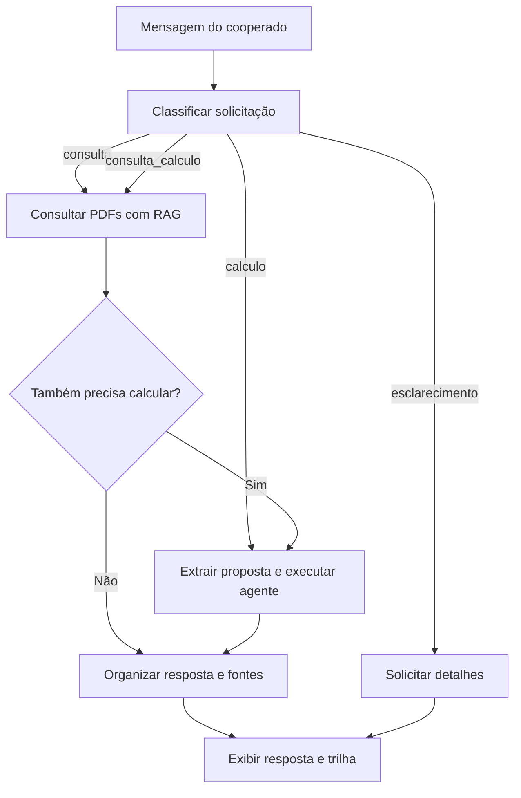

# Credit Intelligence Lab

**IA generativa aplicada ao atendimento de cooperados e à análise de propostas de crédito.**


Três aplicações evolutivas que transformam solicitações em linguagem natural em dados estruturados, indicadores financeiros e respostas fundamentadas em documentos. O projeto combina agentes com ferramentas, recuperação semântica e orquestração condicional para atender diferentes necessidades em um mesmo fluxo.

O cenário é a **Cooperativa Aurora**, uma instituição fictícia criada para o projeto. Os documentos e parâmetros não representam políticas de cooperativas reais.

## Problema de negócio

Uma solicitação de atendimento pode exigir localizar documentos, explicar condições de um produto ou calcular indicadores de uma proposta. O laboratório explora como organizar essas tarefas, separando a interpretação da mensagem, a consulta às regras e a execução dos cálculos.

O sistema oferece:

- extração de dados financeiros com validação de tipos e restrições;
- cálculos executados em Python, utilizando `Decimal`;
- consulta semântica a PDFs com referência ao arquivo e à página;
- seleção do fluxo conforme a intenção do cooperado;
- registro das etapas percorridas durante a execução.

A aplicação apoia a análise e o atendimento. Não concede crédito, não estima probabilidade de inadimplência e não substitui a decisão de uma instituição financeira.

## Evolução dos projetos

| Projeto | Objetivo | Principais componentes |
|---|---|---|
| [01 · Credit Tools](01_credit_tools/) | Extrair uma proposta e produzir indicadores financeiros. | LangChain, Pydantic, agente com ferramentas e `Decimal`. |
| [02 · Credit RAG](02_credit_rag/) | Responder a dúvidas utilizando documentos da cooperativa. | PDFs, embeddings, FAISS e resposta estruturada. |
| [03 · Credit LangGraph](03_credit_lang_graph/) | Encaminhar solicitações para consulta, cálculo, ambos ou esclarecimento. | Classificação, estado compartilhado e roteamento condicional. |

A pasta `03_credit_graph/` contém uma implementação anterior. A integração atual está em **`03_credit_lang_graph/`**.

## Arquitetura da aplicação integrada



O classificador retorna `tipo` e `motivo`, validados por Pydantic. O LangGraph utiliza essa decisão para encaminhar a solicitação. No caminho combinado, a consulta ocorre antes dos cálculos.

O estado guarda mensagem, classificação, contexto, proposta, resultados e trilha. A finalização reúne as respostas disponíveis sem uma nova chamada ao modelo. **Nesta versão, reunir regras e indicadores não equivale a verificar automaticamente o enquadramento da proposta.**

| Componente | Responsabilidade |
|---|---|
| LangChain | Compor prompts, modelos, saídas estruturadas e o agente. |
| Pydantic | Validar os formatos da proposta, da classificação e da resposta documental. |
| Agente com ferramentas | Selecionar as ferramentas aplicáveis aos dados recebidos. |
| Ferramentas Python | Executar operações financeiras e informar dados ausentes. |
| RAG | Recuperar trechos para fundamentar as respostas documentais. |
| LangGraph | Controlar a sequência e os caminhos condicionais. |

## Indicadores financeiros

As ferramentas trabalham com **novo crédito pessoal, com parcelas mensais fixas e sem entrada**.

| Ferramenta | Indicadores |
|---|---|
| `calcular_comprometimento_renda` | Percentual da renda comprometido antes e depois da proposta. |
| `calcular_fluxo_mensal` | Renda restante após parcelas de crédito, antes e depois da proposta. |
| `calcular_total_proposta` | Soma das novas parcelas e diferença em relação ao valor solicitado. |

As ferramentas contemplam resultados parciais. Sem a nova parcela, por exemplo, é possível calcular o comprometimento atual quando renda e parcelas existentes estão disponíveis.

### Exemplo de referência

> Minha renda líquida mensal é R$ 5.500 e pago R$ 700 em parcelas existentes. Tenho uma proposta de crédito pessoal sem entrada de R$ 15.000, em 24 parcelas fixas de R$ 850. Calcule os indicadores da proposta.

| Indicador | Resultado aritmético esperado |
|---|---:|
| Comprometimento atual | 12,73% |
| Comprometimento proposto | 28,18% |
| Renda restante atual | R$ 4.800,00 |
| Renda restante após a proposta | R$ 3.950,00 |
| Total a pagar da nova proposta | R$ 20.400,00 |
| Diferença em relação ao valor solicitado | R$ 5.400,00 |

Os valores são uma referência para conferência, não um registro de teste automatizado. A renda restante não inclui despesas pessoais. A diferença monetária não representa taxa de juros nem CET.

## Base documental e RAG

Cada aplicação com RAG possui sua pasta `documentos/`, com seis PDFs:

| Arquivo | Tema |
|---|---|
| `01_conhecendo_a_cooperativa.pdf` | Cooperativismo, participação e relacionamento. |
| `02_associacao_conta_cadastro.pdf` | Associação, documentação e atualização cadastral. |
| `03_produtos_servicos.pdf` | Produtos e serviços da cooperativa. |
| `04_solicitacao_credito.pdf` | Solicitação e condições de crédito pessoal. |
| `05_dificuldade_pagamento_renegociacao.pdf` | Dificuldades de pagamento e renegociação. |
| `06_seguranca_atendimento.pdf` | Segurança e orientações de atendimento. |

O `PyPDFLoader` carrega os arquivos por página. Os trechos preservam fonte, página, título e assunto; páginas sem texto são ignoradas.

Na aplicação integrada, o `RecursiveCharacterTextSplitter` utiliza trechos de **900 caracteres**, com sobreposição de **350**. Os embeddings são gerados em CPU com `sentence-transformers/paraphrase-multilingual-MiniLM-L12-v2`, normalizados e indexados em FAISS. A consulta recupera até **cinco trechos** por similaridade.

A saída documental usa `RespostaRag`, com `assunto`, `resposta` e `fontes`. Não localizar uma informação nos trechos recuperados não significa que ela inexista na documentação completa.

## Executar localmente

### 1. Preparar o ambiente

Utilize Python de 64 bits compatível com as dependências. **Python 3.12 é a base sugerida**: o código utiliza sintaxe de f-strings disponível a partir dessa versão. São necessários acesso à API Groq e internet para o primeiro download dos embeddings.

```bash
git clone https://github.com/RenanTrevelim/credit-intelligence-lab.git
cd credit-intelligence-lab
```

No Windows, pelo **Prompt de Comando (CMD)**:

```bat
py -3.12 -m venv .venv
.venv\Scripts\activate.bat
python -m pip install --upgrade pip
python -m pip install -r requirements.txt
```

Em Linux ou macOS, com Python 3.12 instalado:

```bash
python3.12 -m venv .venv
source .venv/bin/activate
python -m pip install --upgrade pip
python -m pip install -r requirements.txt
```

O `requirements.txt` registra versões do ambiente de desenvolvimento. A instalação em um ambiente limpo ainda precisa ser validada; a disponibilidade de pacotes binários, como FAISS e PyTorch, depende do Python e do sistema operacional.

### 2. Configurar a chave

Crie um `.env` na raiz:

```dotenv
GROQ_API_KEY=sua_chave_aqui
```

O `.env` já está no `.gitignore`. Não publique sua chave. Os scripts utilizam `openai/gpt-oss-20b` via `ChatGroq`, com temperatura zero.

### 3. Escolher a aplicação

Execute um dos comandos a partir da raiz:

```bash
python 01_credit_tools/main.py
```

```bash
python 02_credit_rag/main.py
```

```bash
python 03_credit_lang_graph/main.py
```

A interação ocorre pelo terminal. Nos projetos com RAG, os documentos e o índice são reconstruídos a cada inicialização. Na aplicação integrada, essa preparação acontece mesmo quando a solicitação será encaminhada apenas para cálculo.

### Pendências da versão atual

Antes de validar os caminhos `calculo` e `consulta_calculo` da aplicação integrada, ajuste a chamada do extrator no nó `calcular`. Ela precisa receber um **dicionário com a chave `mensagem`**, correspondente ao prompt:

```python
proposta = extrator.invoke({
    "mensagem": estado["mensagem"]
})
```

Alinhe também as descrições de `valor_solicitado` e `valor_parcela_proposta` em `PropostaCredito`: dados ausentes devem ser `null`, e não zero. Esses campos possuem a restrição `gt=0`.

## Cenários para demonstração

| Caminho esperado | Mensagem |
|---|---|
| Consulta | Quais documentos preciso apresentar para me associar como MEI? |
| Cálculo | Minha renda líquida é R$ 5.500 e pago R$ 700 em parcelas. Calcule meu comprometimento atual. |
| Consulta e cálculo | Minha renda líquida é R$ 5.500, pago R$ 700 em parcelas e recebi uma proposta sem entrada de R$ 15.000 em 24 parcelas de R$ 850. Calcule os indicadores e consulte os limites de valor, prazo e comprometimento da política. |
| Esclarecimento | Pode resolver isso para mim? |

A aplicação integrada exibe a resposta, o motivo da classificação e a trilha. Os exemplos são cenários de verificação manual; não há métricas de qualidade consolidadas.

## Decisões e limites

- **Separação entre linguagem e cálculo:** o modelo interpreta a solicitação; as ferramentas realizam a aritmética. A escolha das ferramentas depende do agente e precisa ser conferida nos testes.
- **Validação de estrutura:** Pydantic controla tipos e restrições, mas não garante interpretação correta da mensagem.
- **Escopo financeiro:** as ferramentas não simulam juros, CET, entrada ou renegociação. Dúvidas sobre renegociação são tratadas pela consulta documental.
- **Rastreabilidade:** fontes e páginas permitem conferir respostas, e a trilha registra as etapas. Não há validação automática das citações nem auditoria persistente.
- **Execução por solicitação:** não há memória entre conversas, interface web ou integração com contas e sistemas bancários.
- **Recuperação:** não há OCR ou reranking. PDFs digitalizados sem texto exigem uma etapa adicional; a busca semântica não garante recuperar todas as regras relevantes.
- **Dados e privacidade:** embeddings são gerados localmente; mensagens e trechos utilizados nas chamadas são enviados à API Groq. As demonstrações devem utilizar dados fictícios.

## Próximas evoluções

- [ ] Consolidar os quatro caminhos e os cenários com dados incompletos.
- [ ] Criar testes automatizados das ferramentas e do roteamento.
- [ ] Validar e simplificar as dependências para instalação reproduzível.
- [ ] Persistir o índice vetorial para evitar reprocessamento.
- [ ] Avaliar recuperação e respostas com perguntas e evidências de referência.
- [ ] Validar fontes e páginas antes de exibir a resposta.
- [ ] Adicionar interface de conversa e memória por sessão.

## Autor

Desenvolvido por [Renan Assis Trevelim](https://github.com/RenanTrevelim), como parte de um portfólio de aplicações de dados e inteligência artificial para o setor financeiro.
