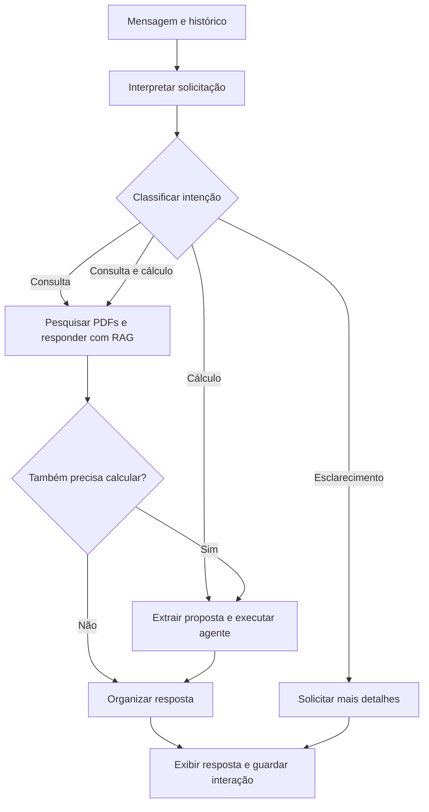

# Credit Intelligence Lab

### Assistente de IA para cooperativas: documentos, cálculos e conversa com histórico

**Um chatbot que consulta documentos em PDF, calcula indicadores financeiros e acompanha alterações de uma proposta ao longo da conversa.**

O projeto combina **LangChain, LangGraph, Pydantic, RAG e Streamlit** para interpretar a necessidade do cooperado e encaminhar o atendimento para consulta documental, cálculo ou ambos.

O repositório contém **três projetos progressivos**. A aplicação final reúne os componentes desenvolvidos nas etapas anteriores em uma interface de conversa.

> **Conheça a aplicação principal:** [`03_credit_lang_graph/`](03_credit_lang_graph/)


## Aplicação em funcionamento


*Consulta em linguagem natural com indicadores calculados por ferramentas Python. Dados extraídos, trechos recuperados e caminho percorrido ficam disponíveis em painéis expansíveis.*

O cenário utiliza a **Cooperativa Aurora**, instituição fictícia criada para fins educacionais. Os documentos não representam políticas de Sicoob, Sicredi, Cresol ou outras instituições reais.

## Evolução do projeto

Cada diretório representa uma etapa de aprendizado e construção da solução.

| Etapa | Projeto | Objetivo |
|---|---|---|
| **01** | [Agente com ferramentas](01_credit_tools/) | Extrair dados com Pydantic e executar cálculos financeiros por meio de um agente LangChain. |
| **02** | [Consulta documental com RAG](02_credit_rag/) | Recuperar informações de PDFs e responder com referências às fontes. |
| **03** | [Assistente integrado](03_credit_lang_graph/) | Integrar consulta, cálculos, histórico e roteamento com LangGraph em uma interface Streamlit. |

**O terceiro projeto é a aplicação final e o principal destaque do repositório.**

## O que o assistente faz?

| Necessidade | Comportamento |
|---|---|
| Consultar documentos | Pesquisa os PDFs e apresenta orientações com referências ao arquivo e à página. |
| Calcular indicadores | Extrai os dados da proposta e aciona ferramentas financeiras. |
| Consultar e calcular | Executa as duas etapas e reúne os resultados. |
| Continuar uma conversa | Utiliza o histórico para compreender referências e alterações na mesma proposta. |
| Esclarecer uma solicitação | Solicita detalhes quando não consegue identificar um caminho de atendimento. |

Na interface, o usuário também pode:

- Conferir os trechos recuperados dos documentos.
- Visualizar os dados utilizados nos cálculos.
- Acompanhar o caminho percorrido pelo grafo.
- Iniciar uma nova conversa, limpando o histórico.

## Arquitetura da aplicação final

O fluxo começa pela interpretação da mensagem com apoio do histórico. Em seguida, a classificação define quais componentes serão utilizados.



### Responsabilidade dos componentes

| Componente | Responsabilidade |
|---|---|
| **Interpretador** | Compreender a mensagem atual usando referências e dados pertinentes do histórico. |
| **Classificador** | Selecionar consulta, cálculo, consulta com cálculo ou esclarecimento. |
| **RAG** | Recuperar trechos e produzir uma resposta apoiada nos documentos. |
| **Extrator** | Organizar as informações no esquema `PropostaCredito`. |
| **Agente** | Acionar as ferramentas aplicáveis aos dados disponíveis. |
| **Finalização** | Reunir os resultados documentais e financeiros. |
| **Streamlit** | Exibir a conversa, manter o histórico da sessão e apresentar os detalhes da execução. |

No caminho combinado, a consulta documental ocorre antes dos cálculos. A finalização reúne os resultados sem uma nova chamada ao modelo.

> Apresentar regras e indicadores juntos não equivale a verificar automaticamente o enquadramento da proposta nem representa aprovação de crédito.

## Histórico da conversa

A aplicação mantém as mensagens em `st.session_state` e envia o histórico ao grafo a cada solicitação.

O interpretador utiliza esse histórico para compreender perguntas complementares e atualizar os dados da mesma proposta.

**Exemplo:**

1. O usuário informa renda, parcelas existentes e condições do crédito.
2. Depois pergunta: “E se a parcela proposta passar para R$ 900?”.
3. O interpretador deve preservar os demais dados e substituir a parcela.
4. O agente executa novamente os cálculos.

As mensagens anteriores ajudam a compreender a solicitação, mas não substituem os documentos como evidência das políticas.

A memória é mantida durante a sessão, sem armazenamento persistente das conversas. O botão **Nova conversa** limpa o histórico.

## Demonstração dos indicadores

### Solicitação inicial

> Minha renda líquida mensal é R$ 5.500 e pago R$ 700 em parcelas existentes. Tenho uma proposta de crédito pessoal sem entrada de R$ 15.000, em 24 parcelas fixas de R$ 850. Calcule meu comprometimento de renda, a renda restante e o total a pagar.

### Resultados esperados

| Indicador | Resultado |
|---|---:|
| Comprometimento atual | 12,73% |
| Comprometimento após a proposta | 28,18% |
| Renda restante atual | R$ 4.800,00 |
| Renda restante após a proposta | R$ 3.950,00 |
| Total a pagar da nova proposta | R$ 20.400,00 |
| Diferença em relação ao valor solicitado | R$ 5.400,00 |

### Continuação da conversa

> E se a parcela proposta passar para R$ 900? Recalcule todos os indicadores dessa mesma proposta.

Mantendo os demais dados:

| Indicador atualizado | Resultado |
|---|---:|
| Comprometimento após a proposta | 29,09% |
| Renda restante após a proposta | R$ 3.900,00 |
| Total a pagar da nova proposta | R$ 21.600,00 |
| Diferença em relação ao valor solicitado | R$ 6.600,00 |

### Ferramentas disponíveis

| Ferramenta | Finalidade |
|---|---|
| `calcular_comprometimento_renda` | Calcular o percentual de renda comprometida antes e depois da proposta. |
| `calcular_fluxo_mensal` | Calcular a renda restante após as parcelas de crédito. |
| `calcular_total_proposta` | Calcular o total das novas parcelas e a diferença sobre o valor solicitado. |

As ferramentas utilizam `Decimal` e permitem resultados parciais quando existem dados suficientes. Sem a nova parcela, por exemplo, ainda é possível calcular os indicadores atuais quando renda e parcelas existentes estão disponíveis.

**Escopo:** novo crédito pessoal com parcelas mensais fixas e sem entrada.

A renda restante não considera outras despesas pessoais. A diferença monetária não representa taxa de juros nem CET.

## Consulta documental com RAG

A aplicação final utiliza seis PDFs:

| Documento | Tema |
|---|---|
| `01_conhecendo_a_cooperativa.pdf` | Cooperativismo, participação e relacionamento. |
| `02_associacao_conta_cadastro.pdf` | Associação, documentação e atualização cadastral. |
| `03_produtos_servicos.pdf` | Produtos e serviços. |
| `04_solicitacao_credito.pdf` | Solicitação de crédito pessoal. |
| `05_dificuldade_pagamento_renegociacao.pdf` | Dificuldades de pagamento e renegociação. |
| `06_seguranca_atendimento.pdf` | Segurança e atendimento. |

### Processamento dos documentos

1. Leitura dos PDFs por página com `PyPDFLoader`.
2. Preservação dos metadados de fonte, página, título e assunto.
3. Divisão do texto em trechos com sobreposição.
4. Geração local de embeddings.
5. Indexação e busca por similaridade com FAISS.
6. Geração de resposta estruturada com base nos trechos recuperados.

### Configuração da aplicação final

| Parâmetro | Configuração |
|---|---|
| Tamanho dos trechos | 900 caracteres |
| Sobreposição | 350 caracteres |
| Recuperação | Até 5 trechos por consulta |
| Modelo de embeddings | `sentence-transformers/paraphrase-multilingual-MiniLM-L12-v2` |
| Execução dos embeddings | CPU, com normalização |
| Banco vetorial | FAISS |

A resposta documental é organizada em `assunto`, `resposta` e `fontes`.

Quando não há evidências suficientes, o assistente é orientado a comunicar a limitação. Não localizar uma informação nos trechos recuperados não significa que ela inexista em toda a documentação.

## Tecnologias utilizadas

| Tecnologia | Aplicação |
|---|---|
| **Python** | Implementação dos fluxos e cálculos. |
| **Streamlit** | Interface de conversa e histórico da sessão. |
| **LangChain** | Prompts, chains e agente com ferramentas. |
| **LangGraph** | Estado e roteamento condicional. |
| **Pydantic** | Esquemas estruturados e validação de dados. |
| **Groq / ChatGroq** | Acesso ao modelo de linguagem. |
| **Hugging Face / Sentence Transformers** | Embeddings multilíngues locais. |
| **FAISS** | Indexação e busca vetorial. |
| **PyPDFLoader / pypdf** | Extração de texto dos PDFs. |
| **Decimal** | Operações com valores financeiros. |
| **python-dotenv** | Carregamento das configurações de ambiente. |

O modelo configurado é `openai/gpt-oss-20b`, com temperatura zero.

O agente utiliza `create_tool_calling_agent` e `AgentExecutor`, de `langchain_classic`. O extrator da proposta utiliza saída em modo JSON com validação pelo esquema Pydantic.

## Organização do repositório

```text
credit-intelligence-lab/
├── 01_credit_tools/
│   └── main.py
├── 02_credit_rag/
│   └── ...
├── 03_credit_lang_graph/
│   ├── documentos/
│   │   └── ... PDFs da Cooperativa Aurora
│   ├── app.py
│   └── main.py
├── docs/
│   └── images/
│       └── aurora-streamlit.png
├── .env.example
├── .gitignore
├── requirements.txt
└── README.md
```

## Como executar

### 1. Clonar o repositório

```bash
git clone https://github.com/RenanTrevelim/credit-intelligence-lab.git
cd credit-intelligence-lab
```

### 2. Preparar o ambiente

Utilize **Python 3.12 de 64 bits**. O código contém f-strings com sintaxe disponível a partir dessa versão.

**Windows — PowerShell:**

```powershell
py -3.12 -m venv .venv
.\.venv\Scripts\Activate.ps1

python -m pip install --upgrade pip
python -m pip install -r requirements.txt
python -m pip install streamlit
```

**Linux ou macOS:**

```bash
python3.12 -m venv .venv
source .venv/bin/activate

python -m pip install --upgrade pip
python -m pip install -r requirements.txt
python -m pip install streamlit
```

### 3. Configurar a API

Crie uma chave no [console da Groq](https://console.groq.com/keys).

Copie `.env.example` para `.env`, na raiz do repositório, e preencha:

```dotenv
GROQ_API_KEY=sua_chave_aqui
```

**Não publique o arquivo `.env` nem sua chave de API.**

### 4. Executar a aplicação com Streamlit

Na raiz do repositório:

```bash
python -m streamlit run 03_credit_lang_graph/app.py
```

Abra o endereço exibido no terminal, normalmente:

```text
http://localhost:8501
```

A primeira inicialização pode demorar devido ao download do modelo de embeddings e à preparação do índice vetorial.

A interface utiliza `st.cache_resource` para reutilizar o grafo entre as interações. O histórico fica separado na sessão de cada conversa.

O índice não é persistido em disco e precisa ser reconstruído em uma nova inicialização do processo.

### Executar pelo terminal

| Projeto | Comando |
|---|---|
| Agente com ferramentas | `python 01_credit_tools/main.py` |
| Consulta documental | `python 02_credit_rag/main.py` |
| Aplicação final | `python 03_credit_lang_graph/main.py` |

Na conversa pelo terminal da aplicação final, digite `sair` para encerrar.

Para parar o servidor Streamlit, pressione `Ctrl + C` no terminal.

## Cenários de avaliação manual

| Cenário | Verificação esperada |
|---|---|
| Documentos para associação como MEI | Consulta aos PDFs e apresentação de fontes pertinentes. |
| Proposta completa | Execução das ferramentas e conferência dos seis indicadores. |
| Alteração da parcela durante a conversa | Preservação dos demais dados e atualização dos cálculos. |
| Correção da renda | Utilização do valor corrigido e das condições mais recentes da proposta. |
| Ausência da nova parcela | Indicadores atuais possíveis e explicação dos dados ausentes. |
| Consulta às regras com pedido de cálculo | Execução dos dois caminhos antes da finalização. |
| Mudança de assunto | Uso do histórico sem misturar solicitações ou propostas diferentes. |
| Nova conversa | Limpeza do histórico anterior. |
| Pergunta sem suporte documental | Comunicação da insuficiência do contexto. |

A interface, os cálculos do exemplo e a continuidade da proposta foram demonstrados manualmente durante o desenvolvimento.

Esses exemplos não substituem testes automatizados. Ainda não há métricas consolidadas de qualidade da recuperação, classificação ou fidelidade das respostas.

## Limites da aplicação

- O assistente não aprova ou reprova crédito, não classifica risco e não executa operações bancárias.
- A busca semântica pode deixar de recuperar trechos relevantes.
- Pydantic valida tipos e restrições, mas não garante interpretação correta da mensagem.
- O histórico é interpretado por uma LLM; correções e mudanças de proposta precisam ser avaliadas.
- A seleção das ferramentas depende do agente.
- As referências documentais ainda não possuem validação automática.
- Não há OCR, persistência de conversas ou integração com sistemas bancários.
- Mensagens e trechos utilizados nas chamadas são enviados à API Groq. As demonstrações devem utilizar dados fictícios.

## Próximas evoluções

- [ ] Automatizar testes das ferramentas financeiras e dos caminhos do grafo.
- [ ] Avaliar conversas com correções, dados incompletos e mudanças de assunto.
- [ ] Persistir o índice vetorial para reduzir o tempo de inicialização.
- [ ] Criar uma base de perguntas e evidências para avaliar o RAG.
- [ ] Validar fontes e páginas antes da apresentação.
- [ ] Consolidar dependências e validar a instalação em ambiente limpo.
- [ ] Medir latência, consumo de tokens e qualidade das respostas.

## Competências demonstradas

- Construção de aplicações com IA generativa.
- Engenharia de prompts para interpretação, classificação e extração.
- Modelagem e validação de dados com Pydantic.
- Integração de LLMs com ferramentas Python.
- Recuperação de informações em múltiplos PDFs.
- Orquestração de fluxos condicionais com LangGraph.
- Histórico conversacional por sessão.
- Desenvolvimento de interfaces com Streamlit.
- Aplicação de IA a necessidades de atendimento do setor financeiro.

## Autor

Desenvolvido por **[Renan Assis Trevelim](https://github.com/RenanTrevelim)**.

Projeto de portfólio voltado ao uso de IA generativa no setor financeiro, com foco em atendimento conversacional, consulta documental e apoio à análise de propostas de crédito.
