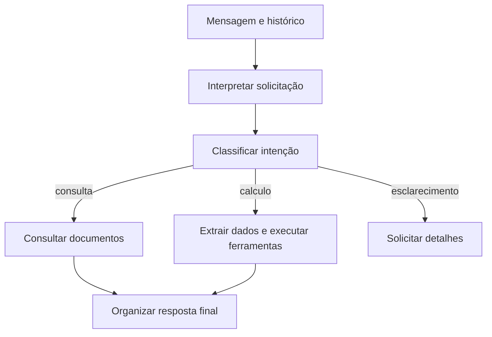

# Credit Intelligence Lab

### Assistente de IA para cooperativas: documentos, cálculos e conversa com histórico

Aplicação que combina **LLMs, RAG e ferramentas Python** para consultar documentos, calcular indicadores financeiros e compreender alterações de uma proposta ao longo da conversa.

O repositório reúne **três projetos desenvolvidos de forma progressiva**. A implementação principal está em **[`03_credit_lang_graph/`](03_credit_lang_graph/)** e integra as etapas anteriores em um assistente com **LangGraph e interface Streamlit**.


> A Cooperativa Aurora e seus procedimentos são fictícios. O projeto tem finalidade educacional, não representa políticas de instituições reais e não aprova ou reprova operações de crédito.

---

## 🚀 Projeto principal — Assistente integrado

O assistente recebe uma solicitação em linguagem natural, interpreta seu significado com apoio do histórico e seleciona o caminho de atendimento.

As demonstrações deste README apresentam a **consulta documental** e os **cálculos financeiros** em solicitações separadas.

| Caminho apresentado | Quando utilizar | Entrega |
|---|---|---|
| `consulta` | Dúvidas sobre documentos, associação, cadastro, produtos e procedimentos | Resposta documental com fontes e páginas |
| `calculo` | Solicitações de indicadores financeiros | Dados da proposta, resultados e limitações |
| `esclarecimento` | Solicitações ambíguas ou fora dos caminhos atendidos | Orientação para detalhar o pedido |

### Recursos da aplicação

- Interface de conversa com Streamlit.
- Histórico para compreender referências e correções.
- Classificação de intenção com saída estruturada.
- Busca semântica em múltiplos PDFs.
- Respostas documentais com arquivos e páginas.
- Extração e validação de dados com Pydantic.
- Cálculos financeiros executados com `Decimal`.
- Roteamento condicional com LangGraph.
- Visualização dos trechos recuperados, dos dados extraídos e do caminho percorrido.
- Opção de iniciar uma nova conversa.

---

## 💬 Demonstrações de uso

Os dois exemplos abaixo mostram usos distintos do mesmo assistente.

As perguntas são sugestões para demonstração. Os valores numéricos apresentados servem como referência para conferir os cálculos.

### 1. Consulta documental — RAG

**Objetivo:** consultar as orientações da cooperativa para solicitar crédito pessoal.

**Exemplo de solicitação**

> Como posso solicitar crédito pessoal na Cooperativa Aurora? Quais documentos e condições preciso apresentar?

**Como funciona**

1. O interpretador identifica o significado da solicitação.
2. O classificador seleciona o caminho `consulta`.
3. O sistema busca trechos relacionados à pergunta nos PDFs.
4. A resposta é organizada com base no contexto recuperado.
5. A interface apresenta a resposta, as fontes e os detalhes da execução.

**O que observar**

A resposta deve apresentar os documentos, as condições e as etapas de solicitação sustentados pelos trechos recuperados, preservando eventuais restrições e exceções.

O assistente deve diferenciar a solicitação de crédito da aprovação da proposta. Caso os trechos sejam insuficientes, deve indicar especificamente quais informações não foi possível confirmar.

Neste caminho, as ferramentas financeiras não são executadas.

**Exemplo na aplicação**


*Consulta aos documentos, com resposta fundamentada e referências aos arquivos e páginas utilizados.*

---

### 2. Indicadores financeiros — Tools

**Objetivo:** extrair os dados informados pelo usuário e executar cálculos por meio de ferramentas Python.

**Exemplo de solicitação**

> Minha renda líquida mensal é R$ 5.500 e pago R$ 700 em parcelas existentes. Tenho uma proposta de crédito pessoal sem entrada de R$ 15.000, em 24 parcelas fixas de R$ 850. Calcule meu comprometimento de renda, a renda restante e o total a pagar.

**Como funciona**

1. O classificador seleciona o caminho `calculo`.
2. O extrator organiza os dados no esquema `PropostaCredito`.
3. O agente aciona as ferramentas compatíveis com os dados disponíveis.
4. A aplicação apresenta o resumo da proposta, os indicadores e as limitações.

**Valores de referência**

| Indicador | Resultado |
|---|---:|
| Comprometimento atual da renda | 12,73% |
| Comprometimento com a nova proposta | 28,18% |
| Renda restante atual | R$ 4.800,00 |
| Renda restante com a nova proposta | R$ 3.950,00 |
| Total a pagar da nova proposta | R$ 20.400,00 |
| Diferença em relação ao valor solicitado | R$ 5.400,00 |

**Como interpretar os resultados**

- A renda restante não considera outras despesas pessoais.
- O total a pagar corresponde somente às parcelas da nova proposta.
- A diferença monetária não representa taxa de juros nem CET.

Neste caminho, não é realizada consulta aos PDFs para gerar a resposta.

**Exemplo na aplicação**


*Indicadores calculados pelas ferramentas, com apresentação dos dados da proposta e das limitações.*

---

## 🧠 Continuidade da conversa

O histórico permite fazer perguntas complementares sem repetir todos os dados da solicitação anterior.

Antes da classificação, um interpretador transforma a mensagem atual em uma solicitação compreensível de forma independente.

**Exemplo após o cálculo da proposta anterior**

> E se a parcela proposta passar para R$ 900? Recalcule todos os indicadores dessa mesma proposta.

O comportamento esperado é preservar renda, parcelas existentes, valor solicitado e quantidade de parcelas, substituindo somente o valor da nova parcela.

| Indicador atualizado | Resultado |
|---|---:|
| Comprometimento com a nova proposta | 29,09% |
| Renda restante com a nova proposta | R$ 3.900,00 |
| Total a pagar da nova proposta | R$ 21.600,00 |
| Diferença em relação ao valor solicitado | R$ 6.600,00 |

O comprometimento atual e a renda restante atual permanecem iguais.

### Uso do histórico

- Esclarecer referências como “essa proposta” ou “esses documentos”.
- Recuperar dados informados anteriormente pelo usuário.
- Aplicar correções explícitas.
- Respeitar mudanças de assunto.
- Evitar misturar informações de pessoas ou propostas diferentes.

O histórico ajuda a interpretar a solicitação, mas **não substitui os documentos como evidência das regras da cooperativa**.

Na interface, as mensagens ficam em `st.session_state`. O botão **Nova conversa** limpa o histórico. Não há armazenamento persistente das conversas.

---

## 🧭 Arquitetura dos fluxos demonstrados



### Responsabilidade dos componentes

| Componente | Responsabilidade |
|---|---|
| Interpretador | Compreender a mensagem atual com apoio do histórico |
| Classificador | Escolher o caminho de atendimento |
| RAG | Recuperar trechos e responder com base nos documentos |
| Extrator | Estruturar os dados da proposta com Pydantic |
| Agente | Acionar as ferramentas financeiras |
| Finalização | Organizar a saída do caminho executado |
| Streamlit | Apresentar a conversa e os detalhes da execução |

O estado do grafo mantém a mensagem original, o histórico, a mensagem interpretada, a classificação, o contexto recuperado, a proposta estruturada, os resultados e a trilha de execução.

A finalização organiza os resultados disponíveis **sem uma nova chamada à LLM**.

---

## 📚 Evolução em três projetos

Cada diretório representa uma etapa de desenvolvimento.

| Etapa | Projeto | Objetivo |
|---|---|---|
| 01 | [`01_credit_tools/`](01_credit_tools/) | Extrair dados com Pydantic e executar ferramentas financeiras |
| 02 | [`02_credit_rag/`](02_credit_rag/) | Consultar PDFs e responder com referências às fontes |
| **03** | **[`03_credit_lang_graph/`](03_credit_lang_graph/)** | **Integrar consulta, cálculos, histórico e roteamento em uma aplicação Streamlit** |

As duas primeiras etapas exploram os componentes individualmente. **O terceiro projeto é a aplicação final e o principal destaque do repositório.**

---

## 📄 Consulta documental com RAG

A base de conhecimento contém seis PDFs da Cooperativa Aurora.

| Documento | Tema |
|---|---|
| `01_conhecendo_a_cooperativa.pdf` | Cooperativismo e relacionamento |
| `02_associacao_conta_cadastro.pdf` | Associação, documentação e cadastro |
| `03_produtos_servicos.pdf` | Produtos e serviços |
| `04_solicitacao_credito.pdf` | Solicitação de crédito pessoal |
| `05_dificuldade_pagamento_renegociacao.pdf` | Dificuldades de pagamento e renegociação |
| `06_seguranca_atendimento.pdf` | Segurança e atendimento |

### Processamento

1. Leitura dos PDFs por página.
2. Preservação dos metadados de arquivo, página, título e assunto.
3. Divisão do texto em trechos com sobreposição.
4. Geração local de embeddings.
5. Indexação e busca por similaridade com FAISS.
6. Geração da resposta estruturada a partir do contexto recuperado.

### Configuração

| Parâmetro | Configuração |
|---|---|
| Leitura | `PyPDFLoader` |
| Divisão | `RecursiveCharacterTextSplitter` |
| Tamanho dos trechos | 900 caracteres |
| Sobreposição | 350 caracteres |
| Recuperação | Até 5 trechos por consulta |
| Embeddings | `sentence-transformers/paraphrase-multilingual-MiniLM-L12-v2` |
| Execução dos embeddings | CPU, com normalização |
| Banco vetorial | FAISS |
| Saída documental | `assunto`, `resposta` e `fontes` |

Não localizar uma informação nos trechos recuperados não significa que ela inexista em toda a documentação.

---

## 🧮 Ferramentas financeiras

| Ferramenta | Finalidade |
|---|---|
| `calcular_comprometimento_renda` | Calcular o percentual de renda comprometida antes e depois da nova proposta |
| `calcular_fluxo_mensal` | Calcular a renda restante após as parcelas de crédito |
| `calcular_total_proposta` | Calcular o total das novas parcelas e a diferença em relação ao valor solicitado |

As ferramentas utilizam `Decimal`. A LLM extrai informações e apresenta os resultados; as operações matemáticas são realizadas pelas funções Python.

### Dados da proposta

O esquema `PropostaCredito` contém:

| Campo | Significado |
|---|---|
| `renda_liquida_mensal` | Renda mensal após descontos |
| `parcelas_mensais_existentes` | Total mensal das parcelas de crédito atuais |
| `valor_solicitado` | Valor do novo empréstimo |
| `quantidade_parcelas` | Número de parcelas da proposta |
| `valor_parcela_proposta` | Valor mensal fixo da nova parcela |

As ferramentas permitem resultados parciais quando existem dados suficientes. Por exemplo, renda líquida e parcelas existentes permitem calcular os indicadores atuais mesmo sem o valor da nova parcela.

**Escopo:** crédito pessoal com parcelas mensais fixas e sem entrada.

---

## 🛠️ Tecnologias

| Tecnologia | Aplicação |
|---|---|
| Python | Implementação dos fluxos e ferramentas |
| Streamlit | Interface de conversa e histórico da sessão |
| LangChain | Prompts, chains e agente com ferramentas |
| LangGraph | Estado e roteamento condicional |
| Pydantic | Estruturação e validação dos dados |
| Groq / ChatGroq | Acesso ao modelo de linguagem |
| Hugging Face / Sentence Transformers | Embeddings multilíngues |
| FAISS | Indexação e busca vetorial |
| PyPDFLoader / pypdf | Extração de texto dos PDFs |
| Decimal | Operações financeiras |
| python-dotenv | Carregamento das variáveis de ambiente |

O modelo configurado é `openai/gpt-oss-20b`, com temperatura zero.

O agente utiliza `create_tool_calling_agent` e `AgentExecutor`, disponíveis em `langchain_classic`.

---

## ▶️ Como executar

### 1. Clonar o repositório

```bash
git clone https://github.com/RenanTrevelim/credit-intelligence-lab.git
cd credit-intelligence-lab
```

### 2. Preparar o ambiente

Utilize **Python 3.12 de 64 bits**. O código contém f-strings com sintaxe disponível a partir dessa versão.

**Windows — PowerShell**

```powershell
py -3.12 -m venv .venv
.\.venv\Scripts\Activate.ps1

python -m pip install -r requirements.txt
python -m pip install streamlit
```

**Linux / macOS**

```bash
python3.12 -m venv .venv
source .venv/bin/activate

python -m pip install -r requirements.txt
python -m pip install streamlit
```

### 3. Configurar a API

Copie `.env.example` para `.env`, na raiz do repositório, e preencha sua chave:

```dotenv
GROQ_API_KEY=sua_chave_aqui
```

**Não publique o arquivo `.env` nem sua chave de API.**

Mantenha os PDFs da aplicação principal em:

```text
03_credit_lang_graph/documentos/
```

### 4. Executar a aplicação principal — Streamlit

Na raiz do repositório, com o ambiente virtual ativado:

```bash
python -m streamlit run 03_credit_lang_graph/app.py
```

A aplicação será aberta no navegador. Caso isso não aconteça automaticamente, acesse o endereço exibido no terminal, normalmente:

```text
http://localhost:8501
```

Na interface, envie uma das perguntas da seção **Demonstrações de uso**.

Também é possível:

- Continuar a conversa com perguntas complementares.
- Conferir os trechos recuperados.
- Visualizar os dados utilizados nos cálculos.
- Consultar o caminho percorrido pelo grafo.
- Limpar o histórico pelo botão **Nova conversa**.

A primeira inicialização pode levar mais tempo devido ao download do modelo de embeddings e à preparação do banco vetorial.

A interface utiliza `st.cache_resource` para reutilizar o grafo. O índice FAISS não é persistido em disco e precisa ser reconstruído ao reiniciar o processo.

Para encerrar o servidor, pressione `Ctrl + C` no terminal.

### 5. Executar pelo terminal — alternativa

| Projeto | Comando |
|---|---|
| Ferramentas financeiras | `python 01_credit_tools/main.py` |
| Consulta documental | `python 02_credit_rag/main.py` |
| Assistente integrado | `python 03_credit_lang_graph/main.py` |

O assistente integrado mantém a conversa durante a execução. Digite `sair` para encerrar.

---

## 🧪 Cenários para avaliação manual

| Cenário | Comportamento esperado |
|---|---|
| Consulta sobre solicitação de crédito | Recuperar orientações aplicáveis e apresentar fontes |
| Proposta completa | Executar as ferramentas e apresentar os indicadores |
| Alteração da parcela | Preservar os demais dados e atualizar os cálculos |
| Correção da renda | Substituir o valor anterior pelo corrigido |
| Ausência da nova parcela | Apresentar os indicadores atuais quando possível |
| Mudança de assunto | Evitar reaproveitar dados de outra solicitação |
| Nova conversa | Limpar o histórico anterior |
| Pergunta sem suporte documental | Comunicar a insuficiência dos trechos recuperados |

Esses cenários orientam a conferência manual. Não substituem testes automatizados nem métricas de qualidade da recuperação, classificação e fidelidade das respostas.

---

## 🔎 Limites da aplicação

- Não aprova ou reprova crédito, não classifica risco e não executa operações bancárias.
- Não calcula CET nem interpreta a diferença monetária como taxa de juros.
- A busca semântica pode deixar de recuperar trechos relevantes.
- Pydantic valida a estrutura dos dados, mas não garante sua interpretação correta.
- A interpretação do histórico e a seleção de ferramentas dependem do modelo.
- As referências documentais não possuem validação automática.
- Não há OCR, persistência de conversas ou integração com sistemas bancários.
- Mensagens e trechos utilizados nas chamadas são enviados à API Groq; as demonstrações devem utilizar dados fictícios.
- O projeto é educacional e não demonstra operação monitorada em ambiente produtivo.

---

## 🔧 Próximas evoluções

- [ ] Automatizar testes das ferramentas e dos caminhos do grafo.
- [ ] Avaliar conversas com correções, dados incompletos e mudanças de assunto.
- [ ] Persistir o índice vetorial para reduzir o tempo de inicialização.
- [ ] Criar uma base de perguntas e evidências para avaliar o RAG.
- [ ] Validar fontes e páginas antes da apresentação.
- [ ] Medir latência, consumo de tokens e qualidade das respostas.

---

## 👨‍💻 Autor

**Renan Assis Trevelim**

Projeto de estudo e portfólio em **IA generativa aplicada ao contexto financeiro**, com foco em atendimento conversacional, consulta documental e indicadores de propostas de crédito.

[GitHub](https://github.com/RenanTrevelim) · [LinkedIn](https://www.linkedin.com/in/renan-trevelim)
