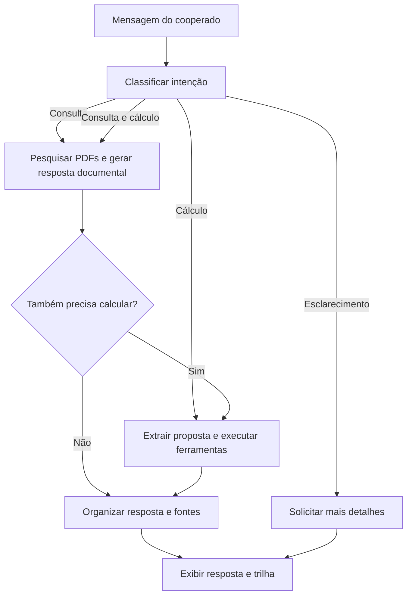

# Credit Intelligence Lab
### Assistente de IA para atendimento em cooperativas e análise de propostas de crédito

Um assistente que entende a solicitação do cooperado, identifica se precisa **consultar documentos, calcular indicadores financeiros ou combinar as duas tarefas** e organiza uma resposta com fontes e registro das etapas executadas.

O projeto integra **LangChain, LangGraph, Pydantic e RAG** em um cenário de atendimento financeiro. A aplicação principal reúne consulta a políticas em PDF e um agente com ferramentas de cálculo, demonstrando como diferentes componentes de IA podem trabalhar em um fluxo orientado à necessidade do usuário.

> **Aplicação principal:** [`03_credit_lang_graph`](03_credit_lang_graph/) — integração de classificação de intenção, consulta documental e cálculos financeiros com orquestração condicional.


## O que o assistente faz?

O usuário descreve sua necessidade em linguagem natural. A aplicação identifica o caminho de atendimento e utiliza os componentes necessários para responder.

| Solicitação | Como o assistente atua |
|---|---|
| “Quais documentos preciso apresentar para me associar como MEI?” | Pesquisa os PDFs e responde com referência ao documento e à página. |
| “Qual será meu comprometimento de renda com essa proposta?” | Extrai os dados financeiros e aciona ferramentas de cálculo. |
| “Calcule os indicadores e consulte os limites da política.” | Executa a consulta documental e os cálculos, apresentando os resultados em uma resposta organizada. |
| “Pode resolver isso para mim?” | Solicita detalhes para compreender a necessidade. |

O cenário utiliza a **Cooperativa Aurora**, uma instituição fictícia com documentos próprios para demonstração. Suas regras não representam políticas de cooperativas reais.

## O problema que motivou o projeto

O atendimento financeiro reúne tarefas que exigem diferentes formas de processamento: interpretar mensagens, localizar regras, identificar dados ausentes e calcular indicadores.

Uma pergunta sobre documentação exige consulta à base de conhecimento. Uma análise de comprometimento exige dados estruturados e operações matemáticas. Uma solicitação mais completa pode precisar das duas etapas.

Este projeto organiza essas necessidades em um fluxo que permite:

- **Consultar informações com referências:** localizar orientações nos documentos e apresentar arquivo e página.
- **Separar interpretação e cálculo:** utilizar o modelo para compreender a mensagem e funções Python para executar a aritmética.
- **Trabalhar com informações incompletas:** produzir os indicadores possíveis e explicar o que ficou indisponível.
- **Encaminhar a solicitação conforme sua intenção:** escolher entre consulta, cálculo, combinação ou esclarecimento.
- **Acompanhar a execução:** exibir o caminho percorrido e o motivo da classificação.

Essas capacidades são demonstradas no código; ganhos de produtividade e qualidade ainda não foram medidos em uma operação real.

## Destaque: aplicação integrada com LangGraph

A aplicação [`03_credit_lang_graph`](03_credit_lang_graph/) concentra a evolução do repositório.

O **LangGraph** coordena as etapas e mantém o estado da solicitação. As chains de **LangChain** realizam classificação, extração e consulta documental. O agente utiliza ferramentas para calcular os indicadores financeiros.



### Etapas do processamento

| Etapa | Responsabilidade |
|---|---|
| **Classificação** | Identificar a intenção e retornar um caminho válido acompanhado de uma justificativa. |
| **Consulta documental** | Recuperar trechos dos PDFs e gerar uma resposta apoiada no contexto. |
| **Extração** | Transformar a mensagem em uma proposta estruturada com Pydantic. |
| **Cálculo** | Executar as ferramentas aplicáveis aos dados disponíveis. |
| **Finalização** | Reunir as respostas e preservar as fontes documentais. |
| **Trilha** | Registrar as etapas realizadas durante aquela execução. |

No caminho combinado, a consulta ocorre antes dos cálculos. A finalização reúne os resultados sem uma nova chamada ao modelo.

**A apresentação conjunta de políticas e indicadores não realiza uma verificação automática de enquadramento nem representa aprovação de crédito.**

## Demonstração dos indicadores

**Solicitação de exemplo:**

> Minha renda líquida mensal é R$ 5.500 e pago R$ 700 em parcelas existentes. Tenho uma proposta de crédito pessoal sem entrada de R$ 15.000, em 24 parcelas fixas de R$ 850. Calcule meu comprometimento de renda, a renda restante e o total a pagar.

**Resultados aritméticos esperados:**

| Indicador | Resultado |
|---|---:|
| Comprometimento atual | 12,73% |
| Comprometimento após a proposta | 28,18% |
| Renda restante atual | R$ 4.800,00 |
| Renda restante após a proposta | R$ 3.950,00 |
| Total a pagar da nova proposta | R$ 20.400,00 |
| Diferença em relação ao valor solicitado | R$ 5.400,00 |

O exemplo serve como referência para conferir os cálculos, não como registro de teste automatizado.

A renda restante considera apenas as parcelas de crédito informadas. A diferença entre o total das parcelas e o valor solicitado não representa taxa de juros nem CET.

### Ferramentas disponíveis

| Ferramenta | Finalidade |
|---|---|
| `calcular_comprometimento_renda` | Calcular o percentual da renda comprometido antes e depois da proposta. |
| `calcular_fluxo_mensal` | Calcular a renda restante após o pagamento das parcelas. |
| `calcular_total_proposta` | Calcular a soma das novas parcelas e a diferença em relação ao valor solicitado. |

As ferramentas utilizam `Decimal` e contemplam resultados parciais. Sem o valor da nova parcela, por exemplo, ainda é possível calcular o comprometimento atual quando renda e parcelas existentes estão disponíveis.

O escopo dos cálculos é **novo crédito pessoal com parcelas mensais fixas e sem entrada**.

## Consulta documental com RAG

A base contém seis PDFs que representam diferentes necessidades do atendimento em uma cooperativa:

| Documento | Tema |
|---|---|
| `01_conhecendo_a_cooperativa.pdf` | Cooperativismo, participação e relacionamento. |
| `02_associacao_conta_cadastro.pdf` | Associação, documentação e atualização cadastral. |
| `03_produtos_servicos.pdf` | Produtos e serviços. |
| `04_solicitacao_credito.pdf` | Solicitação e condições de crédito pessoal. |
| `05_dificuldade_pagamento_renegociacao.pdf` | Dificuldades de pagamento e renegociação. |
| `06_seguranca_atendimento.pdf` | Segurança e orientações de atendimento. |

### Como os documentos são utilizados

1. O `PyPDFLoader` lê os arquivos por página.
2. O conteúdo é dividido em trechos com sobreposição.
3. Os trechos recebem embeddings e são indexados em FAISS.
4. A pergunta é utilizada para recuperar os trechos por similaridade.
5. O modelo produz uma resposta estruturada com base no contexto recuperado.

Os metadados preservam **nome do arquivo, página, título e assunto**.

Na aplicação integrada, a configuração utiliza:

| Parâmetro | Configuração |
|---|---|
| Tamanho dos trechos | 900 caracteres |
| Sobreposição | 350 caracteres |
| Trechos recuperados | Até 5 por consulta |
| Embeddings | `sentence-transformers/paraphrase-multilingual-MiniLM-L12-v2` |
| Execução dos embeddings | CPU, com normalização |
| Índice vetorial | FAISS |

A saída documental é organizada em `assunto`, `resposta` e `fontes`. Informações insuficientes devem ser comunicadas ao usuário: não localizar uma regra nos trechos recuperados não significa que ela inexista em toda a documentação.

## Tecnologias e decisões de implementação

| Tecnologia | Aplicação no projeto |
|---|---|
| **Python** | Implementação dos fluxos e das ferramentas financeiras. |
| **LangChain** | Composição de prompts, modelos, chains e agente com ferramentas. |
| **LangGraph** | Estado compartilhado e roteamento condicional. |
| **Pydantic** | Validação dos formatos de entrada e saída. |
| **Groq / ChatGroq** | Acesso ao modelo de linguagem. |
| **Hugging Face / Sentence Transformers** | Geração local de embeddings multilíngues. |
| **FAISS** | Indexação e busca vetorial. |
| **PyPDFLoader / pypdf** | Extração de texto dos PDFs. |
| **Decimal** | Operações com valores financeiros. |
| **python-dotenv** | Carregamento das configurações de ambiente. |

O modelo configurado é `openai/gpt-oss-20b`, com temperatura zero. O agente utiliza `create_tool_calling_agent` e `AgentExecutor`, disponíveis em `langchain_classic`.

### Competências demonstradas

- Engenharia de prompts para classificação, extração e resposta documental.
- Modelagem de esquemas com Pydantic.
- Integração de LLMs com ferramentas de cálculo.
- Construção de um pipeline RAG com múltiplos PDFs.
- Preservação de metadados para referência às fontes.
- Orquestração de caminhos condicionais com LangGraph.
- Tratamento de dados ausentes e resultados parciais.
- Tradução de necessidades de atendimento em componentes de software.

## Organização do repositório

| Diretório | Papel na evolução |
|---|---|
| [`01_credit_tools/`](01_credit_tools/) | Fundamentos: extração estruturada e agente com ferramentas financeiras. |
| [`02_credit_rag/`](02_credit_rag/) | Consulta documental: recuperação semântica e respostas fundamentadas em PDFs. |
| [`03_credit_lang_graph/`](03_credit_lang_graph/) | Aplicação principal: integração dos componentes com classificação e roteamento. |
| [`03_credit_graph/`](03_credit_graph/) | Implementação anterior, mantida como histórico da evolução. |

Os projetos foram organizados em etapas para tornar visíveis as decisões e os conceitos incorporados ao longo do desenvolvimento.

**Para conhecer a solução integrada, comece por `03_credit_lang_graph/`.**

## Executar localmente

### 1. Clonar o repositório

```bash
git clone https://github.com/RenanTrevelim/credit-intelligence-lab.git
cd credit-intelligence-lab
```

### 2. Preparar o ambiente

Utilize Python de 64 bits compatível com as dependências. **Python 3.12 é a base sugerida**, pois o código utiliza sintaxe de f-strings disponível a partir dessa versão.

No Windows, pelo **Prompt de Comando — CMD**:

```bat
py -3.12 -m venv .venv
.venv\Scripts\activate.bat
python -m pip install --upgrade pip
python -m pip install -r requirements.txt
```

Em Linux ou macOS, com Python 3.12 instalado:

```bash
python3.12 -m venv .venv
source .venv/bin/activate
python -m pip install --upgrade pip
python -m pip install -r requirements.txt
```

O `requirements.txt` registra versões do ambiente de desenvolvimento. A instalação em um ambiente limpo ainda precisa ser validada; pacotes binários como FAISS e PyTorch dependem da compatibilidade entre Python e sistema operacional.

### 3. Configurar a API GROQ

1. Crie uma chave de API em https://console.groq.com/keys.
2. Copie `.env.example` para `.env`.

No Windows, pelo CMD:

```bat
copy .env.example .env
```

No Linux ou macOS:

```bash
cp .env.example .env
```

3. Abra o `.env` e preencha sua chave:

```dotenv
GROQ_API_KEY=sua_chave_aqui
```

O projeto carrega essa configuração com `load_dotenv()`.

O modelo utilizado é `openai/gpt-oss-20b`, configurado na função `criar_modelo()`.

### 4. Executar a aplicação principal

```bash
python 03_credit_lang_graph/main.py
```

Para executar as etapas anteriores:

```bash
python 01_credit_tools/main.py
```

```bash
python 02_credit_rag/main.py
```

A interação ocorre pelo terminal. Nos projetos com RAG, o índice é reconstruído a cada inicialização. Na aplicação integrada, essa preparação ocorre mesmo quando a mensagem será encaminhada apenas para cálculo.

## Cenários de avaliação manual

| Cenário | Verificação esperada |
|---|---|
| Pergunta sobre documentação de MEI | Encaminhar para consulta e apresentar fontes pertinentes. |
| Proposta completa | Encaminhar para cálculo e conferir os seis indicadores do exemplo. |
| Proposta sem nova parcela | Apresentar os resultados atuais possíveis e explicar os dados ausentes. |
| Consulta às regras com pedido de indicadores | Percorrer consulta e cálculo antes da finalização. |
| Pedido sem intenção clara | Encaminhar para esclarecimento. |
| Pergunta sem suporte documental | Informar a insuficiência do contexto, sem inventar regras. |

A trilha exibida ao final ajuda a conferir as decisões de roteamento. Ainda não há métricas consolidadas de qualidade da recuperação, fidelidade das respostas ou acerto da classificação.

## Estado atual e limites

O projeto é um protótipo de portfólio executado pelo terminal. Na versão revisada, foram identificados dois ajustes necessários antes de consolidar os testes dos caminhos de cálculo:

- No nó `calcular`, enviar ao extrator um dicionário com a chave `mensagem`, correspondente à variável do prompt.
- Nas descrições de `valor_solicitado` e `valor_parcela_proposta`, orientar o uso de `null` para dados ausentes, em vez de zero, respeitando a restrição `gt=0`.

Além desses ajustes:

- O agente decide quais ferramentas executar; a execução de todas as ferramentas aplicáveis precisa ser verificada nos testes.
- Pydantic valida estrutura e restrições, mas não garante interpretação correta da mensagem.
- As ferramentas não calculam juros, CET, entrada ou renegociação.
- As citações são geradas pelo modelo e ainda não passam por validação automática.
- Não há OCR, reranking, memória entre conversas ou persistência da trilha.
- Não há integração com contas, transações ou sistemas bancários.
- Os embeddings são gerados localmente; mensagens e trechos usados nas chamadas são enviados à API Groq. As demonstrações devem utilizar dados fictícios.

## Próximas evoluções

- [ ] Consolidar a validação dos quatro caminhos e dos casos com informações incompletas.
- [ ] Criar testes automatizados das ferramentas financeiras e do roteamento.
- [ ] Validar e simplificar as dependências para instalação reproduzível.
- [ ] Persistir o índice vetorial para evitar reprocessamento.
- [ ] Construir uma base de avaliação com perguntas e evidências de referência.
- [ ] Validar fontes e páginas antes de apresentar a resposta.
- [ ] Adicionar interface de conversa e memória por sessão.
- [ ] Acompanhar latência, custo por solicitação e qualidade das respostas.

## Autor

Desenvolvido por **[Renan Assis Trevelim](https://github.com/RenanTrevelim)**.

Projeto de portfólio voltado à aplicação de dados e inteligência artificial no setor financeiro, com foco em atendimento, consulta documental e apoio à análise de propostas de crédito.
